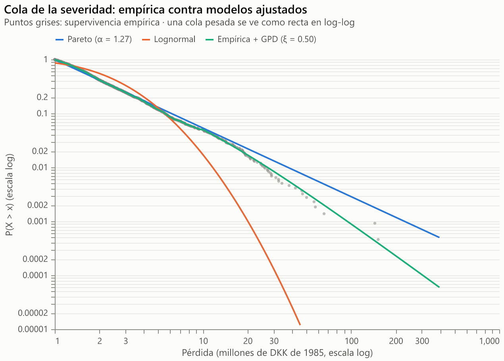
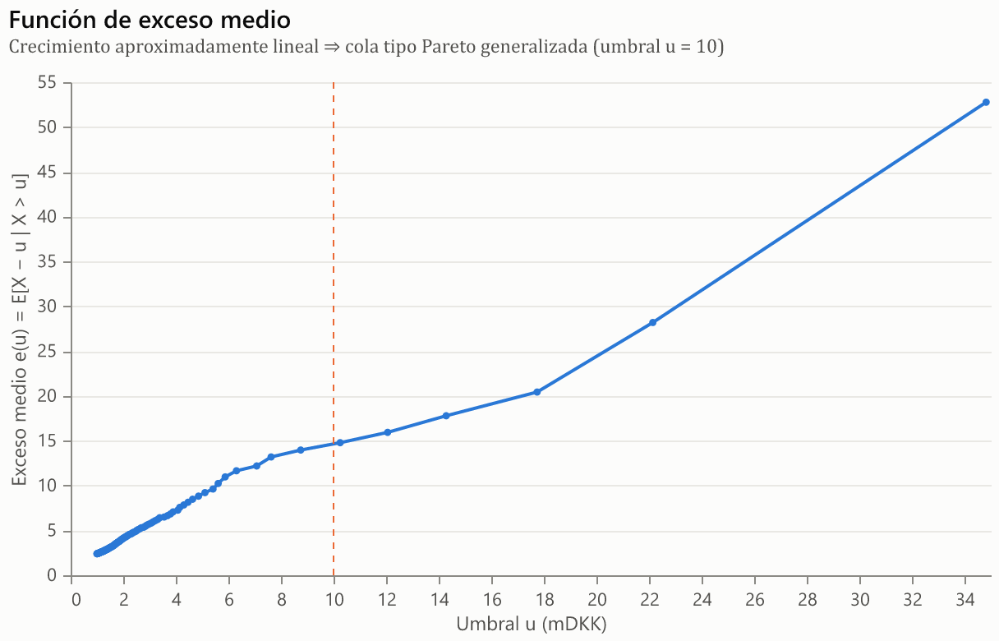
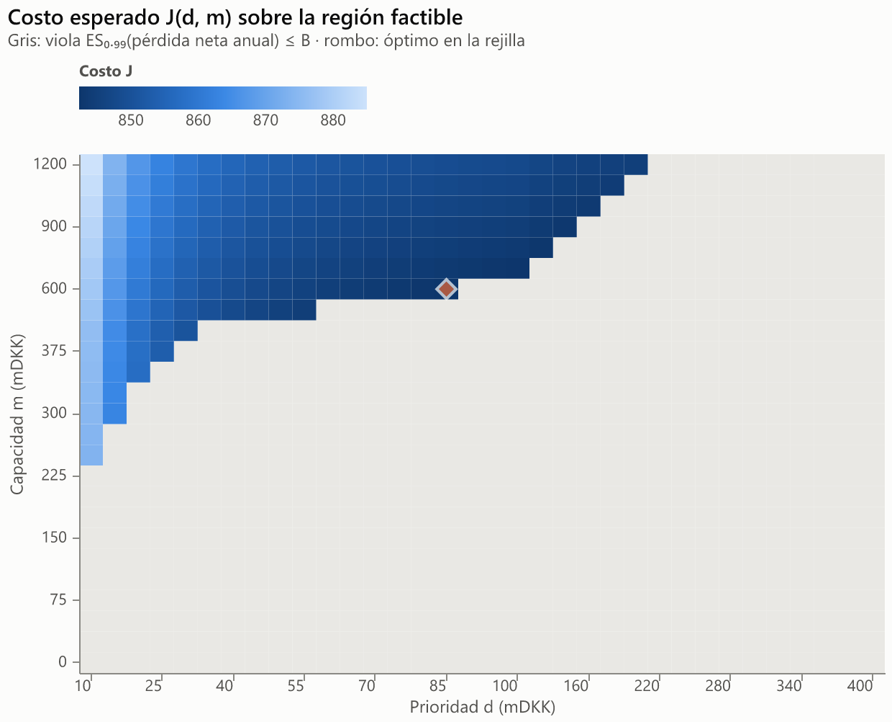
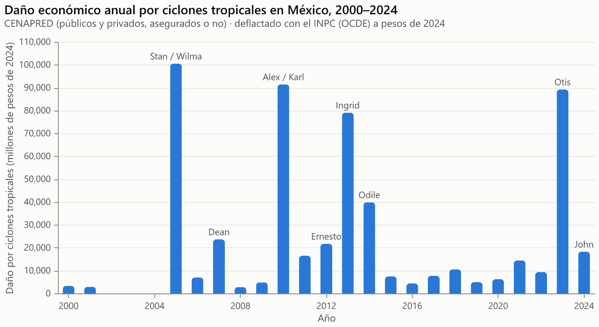
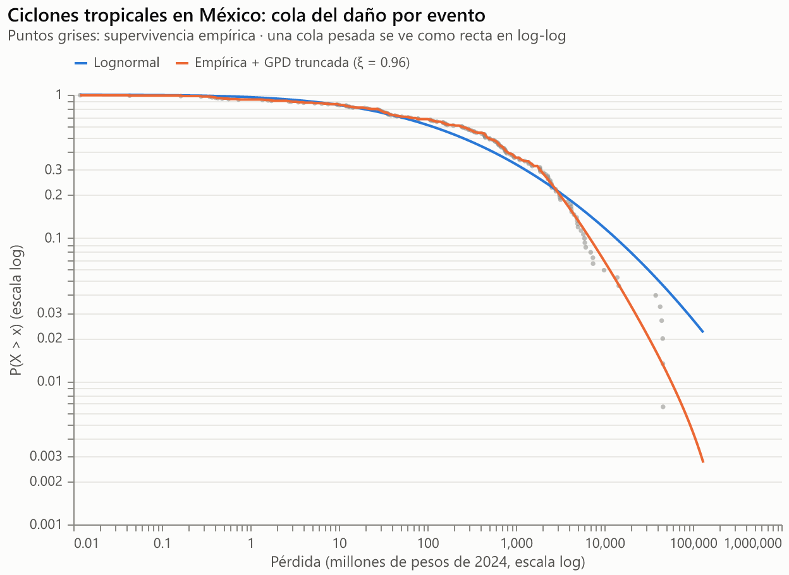
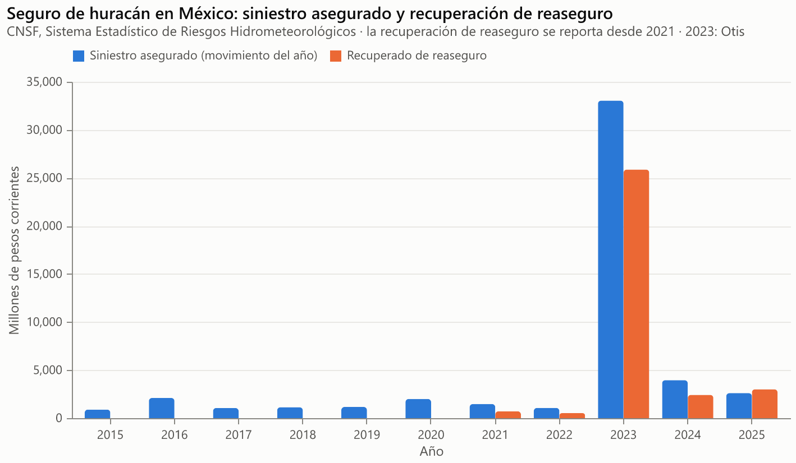
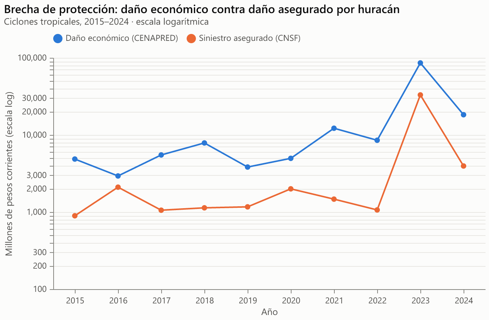
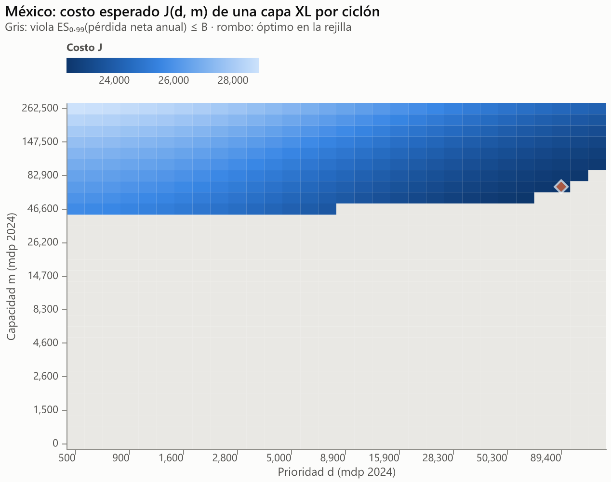
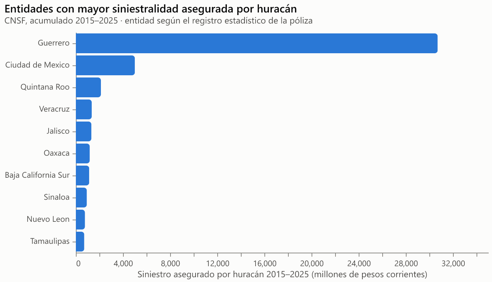
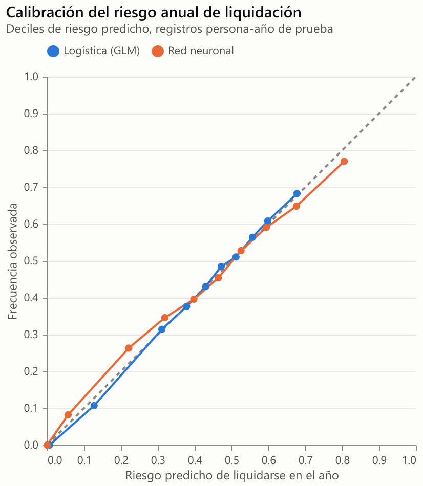

# Actuarial Sciences: reaseguro XL y supervivencia de siniestros con datos reales

Notas de investigación y docencia sobre **reaseguro catastrófico de exceso de pérdida**, más un
módulo reproducible de Python que lleva sus métodos a **datos reales**: incendios daneses, siniestros franceses y
**casos mexicanos** (ciclones y sismos del CENAPRED y seguro de huracán y terremoto de la CNSF). Las gráficas se hacen con Altair.

| | |
|---|---|
| Notas (PDF) | [`notas/Reaseguro_XL_Investigacion_Operaciones.pdf`](notas/Reaseguro_XL_Investigacion_Operaciones.pdf) |
| **Soluciones de los problemas (PDF)** | [`notas/Soluciones_Problemas.pdf`](notas/Soluciones_Problemas.pdf): los 7 problemas propuestos, resueltos a detalle |
| **Guía para bajar los datos** | [`DATOS.md`](DATOS.md): camino automático y manual, huellas SHA-256, diccionario y problemas frecuentes |
| Notebook de resultados | [`notebooks/Resultados.ipynb`](notebooks/Resultados.ipynb) (sólo muestra; no calcula) |
| Módulo | [`actuarial/`](actuarial) (datos, reaseguro, México, supervivencia, gráficas, pipeline) |
| Datos mexicanos derivados | [`datos_mx/`](datos_mx) (extractos + `manifest.json` con URL y SHA-256 de cada fuente oficial) |

## Reproducir

```bash
pip install -r requirements.txt
python -m actuarial.descargar        # baja y verifica todos los datos (ver DATOS.md)
python notas/optimizacion_xl.py      # ejemplo exacto de las notas (salida idéntica a la del .tex)
python notas/soluciones_problemas.py # verificación de los Problemas 1-6
python -m actuarial.problemas        # Problema 7 con datos reales
python -m actuarial                  # todo el estudio: results/ y figures/  (~8 min en CPU)
jupyter lab notebooks/Resultados.ipynb
```

Los datos se descargan la primera vez a `data/raw/` desde un commit fijo de
[CASdatasets](https://github.com/dutangc/CASdatasets) y se verifica su SHA-256. No se redistribuyen aquí
porque tienen licencia GPL (≥ 2). Semilla fija: `2026`.

Los datos mexicanos son datos abiertos oficiales. `python -c "from actuarial import mexico; mexico.build()"` vuelve a
descargarlos de CENAPRED, CNSF y FRED y regenera `datos_mx/`. El análisis sólo lee esos extractos, así que corre sin red.

## Contenido

```
notas/      Reaseguro_XL_Investigacion_Operaciones.tex/.pdf  +  optimizacion_xl.py (incluido por \lstinputlisting)
            Soluciones_Problemas.tex/.pdf  +  soluciones_problemas.py (verificación de los Problemas 1-6)
actuarial/  data.py          descarga verificada; construye tiempos de liquidación y censura
            mexico.py        CENAPRED + CNSF + INPC: eventos, deflactor, cola GPD truncada, capa XL, brecha de protección
            problemas.py     Problema 7: dispersión, lognormal contra GPD, KS bootstrap, backtest de cola fuera de muestra
            descargar.py     python -m actuarial.descargar [--cas | --mx | --local]
            reinsurance.py   Poisson con tendencia, Pareto/lognormal/GPD, prima por capa, simulación y optimización (d, m)
            survival.py      red neuronal en tiempo discreto con censura, GLM, Kaplan–Meier, Brier IPCW, reserva descontada
            charts.py        tema Altair; renderer Vega-Lite + PNG (interactivo en Jupyter, visible en GitHub)
            pipeline.py      run_all(): ejecuta todo y escribe figures/ y results/resumen.json
datos_mx/   extractos derivados de las fuentes mexicanas y manifest.json
notebooks/  Resultados.ipynb
scripts/    actuarial_survival_nn_synthetic.py   versión original con datos simulados
```

## 1. Las notas

Un contrato por ocurrencia $R_{d,m}(X)=\min\{(X-d)^+,m\}$, su prima pura
$\mathbb E R_{d,m}=\int_d^{d+m}\overline F_X$, y el problema $\min J(d,m)$ sujeto a $\mathrm{ES}_\alpha(N)\le B$.
El ejemplo discreto, cuya escala proviene de cifras públicas de AXA y AMIS (Otis), tiene solución analítica
**d\* = 380, m\* = 2748, J = 475.73**, y `optimizacion_xl.py` la valida (`Validation: PASS`).


## 2. Reaseguro XL con pérdidas reales: incendios daneses (Copenhagen Re, 1980–1990)

2 167 pérdidas de más de 1 millón de DKK (valores de 1985), el conjunto clásico de Embrechts, Klüppelberg y Mikosch (1997).

| Resultado | Valor |
|---|---|
| Frecuencia: GLM de Poisson con tendencia | +3.9% anual; λ̂(1991) = 246; sobredispersión de Pearson ≈ 2.0 |
| Cola: GPD sobre u = 10 (109 excesos) | ξ = 0.50 (IC bootstrap 95%: 0.18–0.75), β = 6.98 |
| Pareto de un parámetro | α = 1.27 (sobreestima la cola); la lognormal la subestima |
| Pérdida anual bruta (50 000 años simulados) | E S = 830; ES₀.₉₉ = 1 794 mDKK |
| **Capa óptima** con ES₀.₉₉(neta) ≤ 75% del bruto (θ = 0.25, γ = 0.01) | **d = 85, m = 600 mDKK**, prima 35.5, ES neto 1 345 |

<p>
 
 
</p>

## 3. Casos mexicanos

**Daño económico por ciclones tropicales, CENAPRED 2000–2024.** Son 151 eventos con daño reportado, en pesos de 2024
(deflactados con el INPC de la OCDE). Los mayores son Otis 2023 ($87 498 M), Stan 2005 ($46 013 M), Alex 2010 ($45 810 M),
Karl/Matthew 2010, Ingrid/Manuel 2013, Wilma 2005 ($42 674 M) y Odile 2014 ($37 995 M).

| Resultado | Valor |
|---|---|
| Frecuencia | 6.0 eventos con daño por año; varianza/media ≈ 3.1 (sobredispersión) |
| Cola: GPD sobre el percentil 70 (45 excesos) | **ξ = 0.96** (IC bootstrap 95%: 0.52–1.31): media posiblemente infinita, el doble de pesada que la danesa |
| Supuesto de truncación | pérdida máxima probable = 3 × Otis ≈ $262 500 M |
| Capa XL óptima por ciclón (ES₀.₉₉ neto ≤ 75% del bruto) | **d ≈ $89 400 M, m ≈ $68 400 M**: una capa por encima de un evento del tamaño de Otis |
| Sensibilidad (PML de 2× a 5× Otis; umbral en p60–p80) | d\* entre $51 300 M y $143 900 M: **la PML supuesta es la decisión que más pesa** |

**Seguro y reaseguro, CNSF 2015–2025.** En 2023 el siniestro asegurado por huracán fue de **$33 044 M** y el reaseguro recuperó
**$25 872 M (78%)**. En años ordinarios la cesión es de 0 a 50%: es la no linealidad de las capas XL, visible en datos de
mercado. Entre 2015 y 2024, lo asegurado por huracán equivale a ~31% del daño económico estimado por CENAPRED.

<p>
 
 
 
</p>

## 4. Supervivencia neuronal de expedientes: incendio comercial, Francia 1992–2007

58 056 siniestros individuales con incurrido y pagado por año de desarrollo (`freclaimset3fire9207`).
**Evento**: primer cierre anual con pagado = incurrido > 0. **Censura**: expediente abierto al cierre de 2007.
54 082 liquidados, 3 974 censurados; 2% se reabre después de liquidarse. División 60/15/25 con paro temprano por
verosimilitud de validación.

| Modelo (conjunto de prueba, n = 14 515) | NLL censurada por siniestro | Brier IPCW medio (h = 1, 2, 3, 5, 8) |
|---|---|---|
| Kaplan–Meier | 1.481 | 0.123 |
| Logística en tiempo discreto | 1.288 | 0.104 |
| **Red neuronal** | **1.227** | **0.099** |

Reserva de casos de los 4 268 expedientes de prueba abiertos al cierre del año 2: **€289.3 M nominales,
€264.9 M descontados al 3%** (factor 0.916; 2.2 años esperados hasta la liquidación).

<p>
 
 
</p>

## 5. Problemas propuestos: resumen de soluciones

| # | Resultado |
|---|---|
| 1 | Capa (500, 1500): E R = 175, J = 440.15, pero ES₀.₉₅(N) = 1 628: agotamiento vertical (1 128 sobre d + m) |
| 2 | Prueba sin Tonelli por linealidad de una suma finita; E R = Σ P(X > aⱼ)·\|Iⱼ ∩ [d, d+m]\| (36 + 150 + 81.4 = 267.4) |
| 3 | Para todo B < 3128: d\* = B, m\* = 3128 − B (única). J = 486.78, 475.73 y 460.78 para B = 250, 380 y 600; precio sombra −0.085 / −0.0475 / −0.0225 |
| 4 | Con Π ≤ 350 el problema es **infactible** (prima mínima 361.73); lo mejor alcanzable es ES₀.₉₅(N) ≤ 410.47 |
| 5 | Dos eventos/año: agregado 538.68 > ocurrencia 534.80 en media, pero en cola gana la ocurrencia (ES 760 contra 986.4); prima de reinstalación esperada 59.28 y ES con prima incluida 1 114.67 |
| 6 | ES₀.₉₉₅ = ES₀.₉₅ = 3128: el modelo es ciego sobre el 95%. Un refinamiento con la misma media lleva ES₀.₉₉₅ a 4 280 y rompe la restricción al 95% (495.2) |
| 7 | Poisson rechazada en Dinamarca y México. Lognormal rechazada en la cola danesa (35 contra 6.6 excedencias al 99%); GPD no rechazada. En México la prueba no tiene potencia (ξ de entrenamiento = 1.04) |

## Alcance y advertencias

* Tarifa, θ, γ, α y B son supuestos didácticos; no son cotizaciones de mercado ni la regla de capital de la CNSF (CUSF 6.4).
* Las cifras de AXA y AMIS sólo fijan escala en el ejemplo de las notas; no se reconstruye ningún contrato.
* `freclaimset3fire9207` es una muestra aleatorizada de un asegurador francés no identificado. La reserva descontada
  supone que el saldo de caso se paga al liquidar. Es una reserva de casos, no IBNR.
* CENAPRED mide daño económico total (público y privado, asegurado o no; metodología DaLA de la CEPAL). La CNSF reporta
  movimientos anuales de siniestros asegurados del mercado. No son la misma magnitud y su cociente es sólo indicativo.
* La capa mexicana se calcula sobre daño nacional: se lee como la estructura de un bono catastrófico o de un programa
  paramétrico, no como el contrato de una aseguradora. La sensibilidad a la PML y al umbral está en el notebook.
* La "entidad" de la CNSF es la del registro estadístico de la póliza; por eso la Ciudad de México aparece segunda.

## Fuentes de datos

* CENAPRED, *Base histórica de impacto socioeconómico de desastres 2000–2024*, Atlas Nacional de Riesgos. http://www.atlasnacionalderiesgos.gob.mx/archivo/descargas.html
* CNSF, Datos Abiertos: Sistemas Estadísticos de Riesgos Hidrometeorológicos (57) y de Terremoto y Erupción Volcánica (60). https://www.cnsf.gob.mx/Transparencia/Paginas/DatosAbiertos.aspx
* OCDE, índice de precios al consumidor de México (`MEXCPIALLMINMEI`), vía FRED. https://fred.stlouisfed.org/series/MEXCPIALLMINMEI

* Dutang, C. y Charpentier, A., *CASdatasets: Insurance datasets*, v1.2-1, commit `227fb56`. https://github.com/dutangc/CASdatasets
* Charpentier, A. (ed.), *Computational Actuarial Science with R*, CRC Press, 2014.
* McNeil, A. (1997), Estimating the tails of loss severity distributions using extreme value theory, *ASTIN Bulletin* 27(1).
* Graf, E., Schmoor, C., Sauerbrei, W. y Schumacher, M. (1999), Assessment and comparison of prognostic classification schemes for survival data, *Statistics in Medicine* 18.
