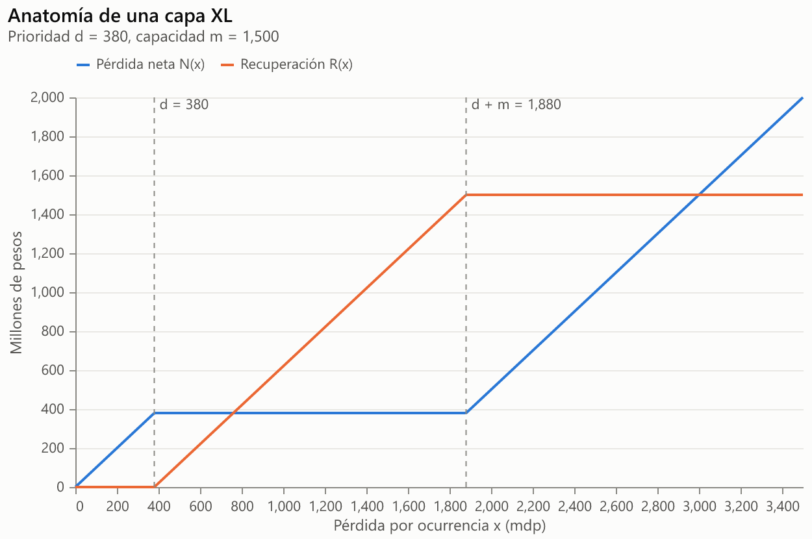
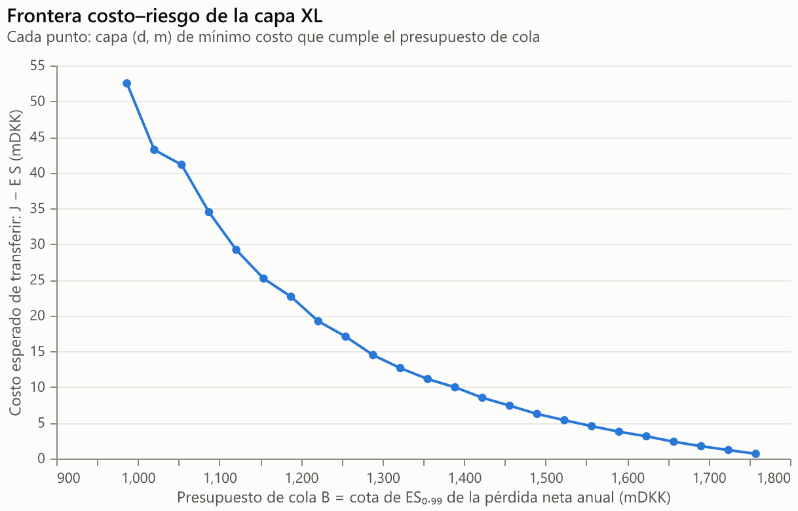
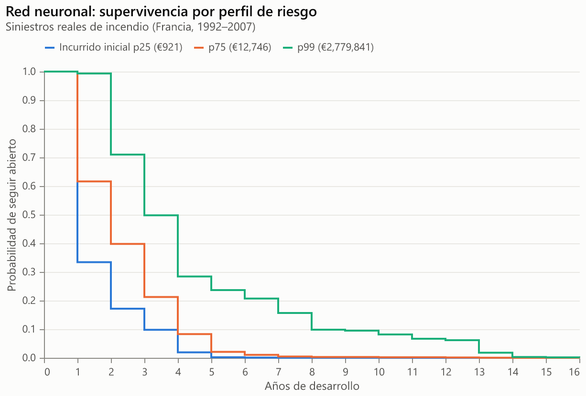
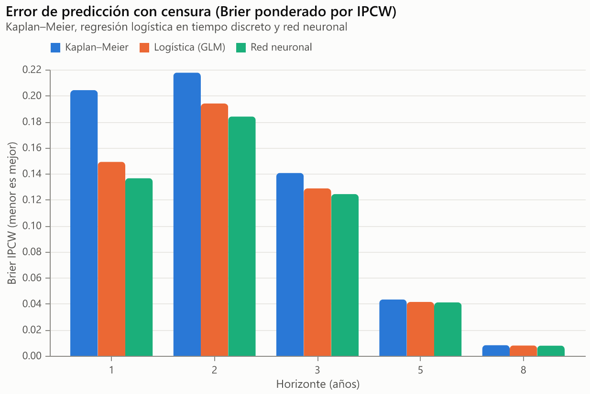
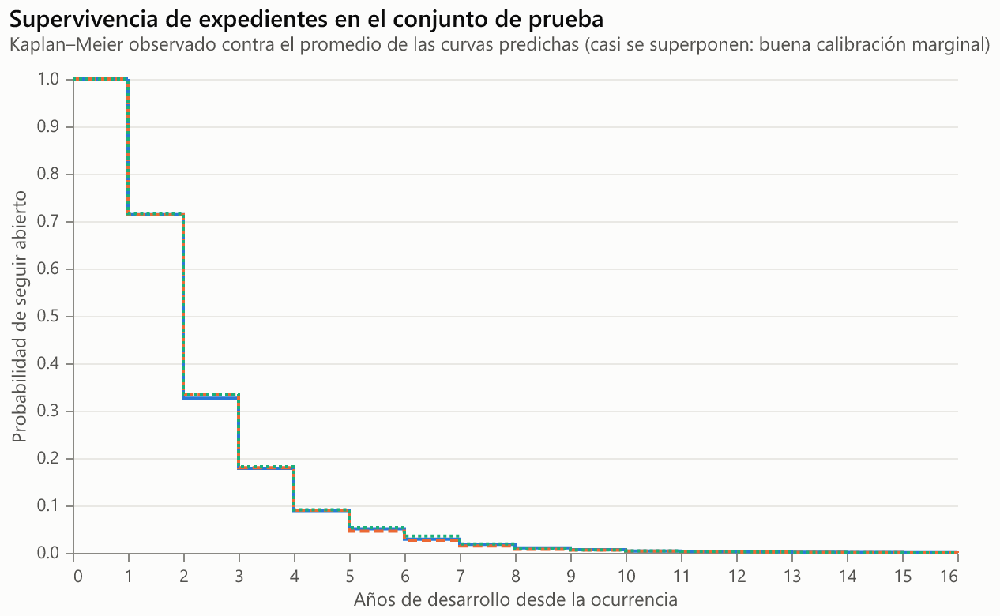

# Actuarial Sciences: reaseguro XL y supervivencia de siniestros con datos reales

Notas de investigación y docencia sobre **reaseguro catastrófico de exceso de pérdida**, más un
módulo reproducible de Python que lleva sus métodos a **datos reales**. Las gráficas se hacen con Altair.

| | |
|---|---|
| Notas (PDF) | [`notas/Reaseguro_XL_Investigacion_Operaciones.pdf`](notas/Reaseguro_XL_Investigacion_Operaciones.pdf) |
| Notebook de resultados | [`notebooks/Resultados.ipynb`](notebooks/Resultados.ipynb) (sólo muestra; no calcula) |
| Módulo | [`actuarial/`](actuarial) (datos, reaseguro, supervivencia, gráficas, pipeline) |

## Reproducir

```bash
pip install -r requirements.txt
python -m actuarial                  # todo el estudio: results/ y figures/  (~4 min en CPU)
python notas/optimizacion_xl.py      # ejemplo exacto de las notas (salida idéntica a la del .tex)
jupyter lab notebooks/Resultados.ipynb
```

Los datos se descargan la primera vez a `data/raw/` desde un commit fijo de
[CASdatasets](https://github.com/dutangc/CASdatasets) y se verifica su SHA-256. No se redistribuyen aquí
porque tienen licencia GPL (≥ 2). Semilla fija: `2026`.

## Contenido

```
notas/      Reaseguro_XL_Investigacion_Operaciones.tex/.pdf  +  optimizacion_xl.py (incluido por \lstinputlisting)
actuarial/  data.py          descarga verificada; construye tiempos de liquidación y censura
            reinsurance.py   Poisson con tendencia, Pareto/lognormal/GPD, prima por capa, simulación y optimización (d, m)
            survival.py      red neuronal en tiempo discreto con censura, GLM, Kaplan–Meier, Brier IPCW, reserva descontada
            charts.py        tema Altair; renderer Vega-Lite + PNG (interactivo en Jupyter, visible en GitHub)
            pipeline.py      run_all(): ejecuta todo y escribe figures/ y results/resumen.json
notebooks/  Resultados.ipynb
scripts/    actuarial_survival_nn_synthetic.py   versión original con datos simulados
```

## 1. Las notas

Un contrato por ocurrencia $R_{d,m}(X)=\min\{(X-d)^+,m\}$, su prima pura
$\mathbb E R_{d,m}=\int_d^{d+m}\overline F_X$, y el problema $\min J(d,m)$ sujeto a $\mathrm{ES}_\alpha(N)\le B$.
El ejemplo discreto, cuya escala proviene de cifras públicas de AXA y AMIS (Otis), tiene solución analítica
**d\* = 380, m\* = 2748, J = 475.73**, y `optimizacion_xl.py` la valida (`Validation: PASS`).



## 2. Reaseguro XL con pérdidas reales: incendios daneses (Copenhagen Re, 1980–1990)

2 167 pérdidas de más de 1 millón de DKK (valores de 1985), el conjunto clásico de Embrechts, Klüppelberg y Mikosch (1997).

| Resultado | Valor |
|---|---|
| Frecuencia: GLM de Poisson con tendencia | +3.9% anual; λ̂(1991) = 246; sobredispersión de Pearson ≈ 2.0 |
| Cola: GPD sobre u = 10 (109 excesos) | ξ = 0.50 (IC bootstrap 95%: 0.18–0.75), β = 6.98 |
| Pareto de un parámetro | α = 1.27 (sobreestima la cola); la lognormal la subestima |
| Pérdida anual bruta (50 000 años simulados) | E S = 830; ES₀.₉₉ = 1 794 mDKK |
| **Capa óptima** con ES₀.₉₉(neta) ≤ 75% del bruto (θ = 0.25, γ = 0.01) | **d = 85, m = 600 mDKK**, prima 35.5, ES neto 1 345 |

<p>
 
 
</p>

## 3. Supervivencia neuronal de expedientes: incendio comercial, Francia 1992–2007

58 056 siniestros individuales con incurrido y pagado por año de desarrollo (`freclaimset3fire9207`).
**Evento**: primer cierre anual con pagado = incurrido > 0. **Censura**: expediente abierto al cierre de 2007.
54 082 liquidados, 3 974 censurados; 2% se reabre después de liquidarse. División 60/15/25 con paro temprano por
verosimilitud de validación.

| Modelo (conjunto de prueba, n = 14 515) | NLL censurada por siniestro | Brier IPCW medio (h = 1, 2, 3, 5, 8) |
|---|---|---|
| Kaplan–Meier | 1.481 | 0.123 |
| Logística en tiempo discreto | 1.288 | 0.104 |
| **Red neuronal** | **1.227** | **0.099** |

Reserva de casos de los 4 268 expedientes de prueba abiertos al cierre del año 2: **€289.3 M nominales,
€264.9 M descontados al 3%** (factor 0.916; 2.2 años esperados hasta la liquidación).

<p>
 
 
</p>

## Alcance y advertencias

* Tarifa, θ, γ, α y B son supuestos didácticos; no son cotizaciones de mercado ni la regla de capital de la CNSF (CUSF 6.4).
* Las cifras de AXA y AMIS sólo fijan escala en el ejemplo de las notas; no se reconstruye ningún contrato.
* `freclaimset3fire9207` es una muestra aleatorizada de un asegurador francés no identificado. La reserva descontada
  supone que el saldo de caso se paga al liquidar. Es una reserva de casos, no IBNR.
* `datos.gob.mx` (bases de terremoto e hidrometeorológicos de la CNSF) bloquea la descarga automatizada; se proponen
  como extensión mexicana en la sección 10 de las notas.

## Fuentes de datos

* Dutang, C. y Charpentier, A., *CASdatasets: Insurance datasets*, v1.2-1, commit `227fb56`. https://github.com/dutangc/CASdatasets
* Charpentier, A. (ed.), *Computational Actuarial Science with R*, CRC Press, 2014.
* McNeil, A. (1997), Estimating the tails of loss severity distributions using extreme value theory, *ASTIN Bulletin* 27(1).
* Graf, E., Schmoor, C., Sauerbrei, W. y Schumacher, M. (1999), Assessment and comparison of prognostic classification schemes for survival data, *Statistics in Medicine* 18.
